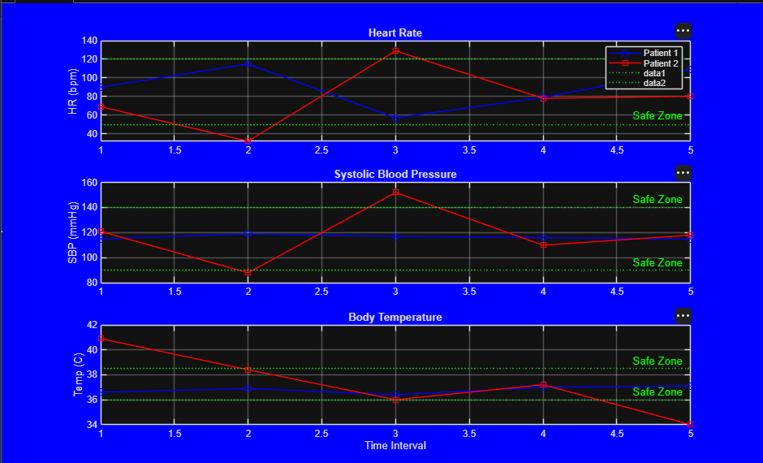

# Multi-Patient Vital Signs & Triage Alert Engine

A MATLAB triage engine that screens patient vital signs against safe clinical ranges, logs critical alerts, and plots telemetry trends.

Built by **Team CodeX** for the FUTMinna MATLAB Space bootcamp, *Beyond The Code: Decode Your World* (in collaboration with MathWorks). Track 2, Group 2.

## Team

| Member | Role |
|---|---|
| Peter Onah Apeh | Team Lead |
| Mercy Akinola | Member |
| Paul Terna | Member |
| Ismail Wildan | Member |

## What it does

- Stores vitals for multiple patients in one 3-D array: `patients x vitals x time steps`.
- Checks every reading against safe ranges.
- Prints an alert for each abnormal reading and returns the total alert count.
- Plots heart rate, systolic blood pressure and temperature with safe-zone lines.

## Safe ranges

| Vital | Safe zone |
|---|---|
| Heart rate | 50 - 120 bpm |
| Systolic BP | 90 - 140 mmHg |
| Temperature | 36.0 - 38.5 °C |

## Files

| File | Purpose |
|---|---|
| `main_track2.m` | Main script. Builds sample data, calls the engine, draws the plots. |
| `triageMonitor.m` | Function `alertCount = triageMonitor(vitalsMatrix)`. |
| `docs/` | Project documentation and dashboard image. |

## How to run

1. Put both `.m` files in the same folder.
2. Open `main_track2.m` in MATLAB.
3. Click **Run**.

## Sample output

```
ALERT: Patient 2 at Time 1 | HR: 69, SBP: 121, Temp: 40.9
ALERT: Patient 2 at Time 2 | HR: 32, SBP: 88, Temp: 38.4
ALERT: Patient 2 at Time 3 | HR: 129, SBP: 152, Temp: 36.0
ALERT: Patient 2 at Time 5 | HR: 80, SBP: 118, Temp: 34.0

 Total Critical Incidents Logged: 4
```



## Planned improvements

- Pop-up alerts with `msgbox` and a sound with `beep`, so a critical reading cannot be missed.
- Load vitals from a file or live feed.
- Severity levels instead of a single alert type.
- More vitals, such as oxygen saturation.

## Documentation

Full write-up: [`docs/TeamCodeX_Documentation.docx`](docs/TeamCodeX_Documentation.docx)
